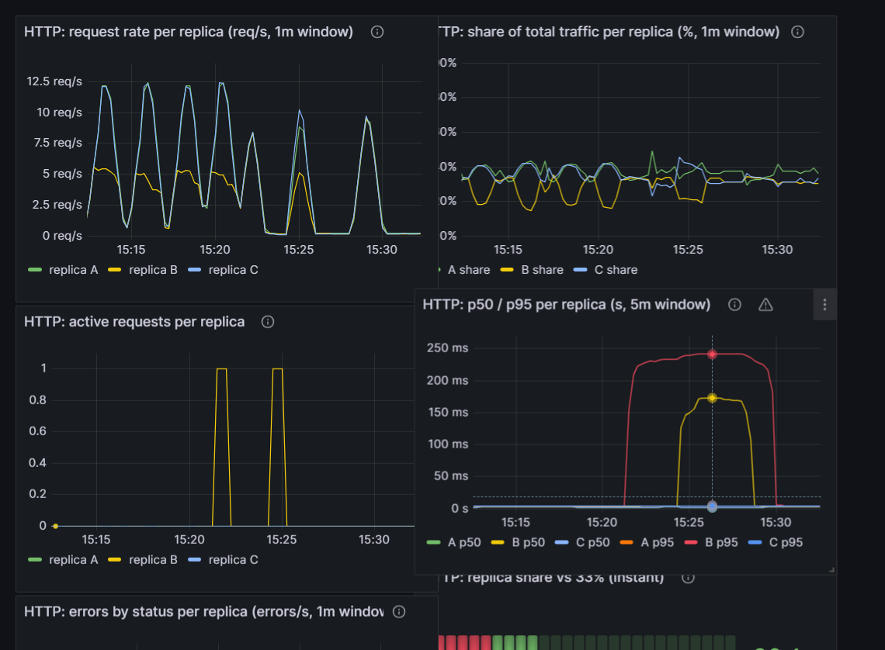
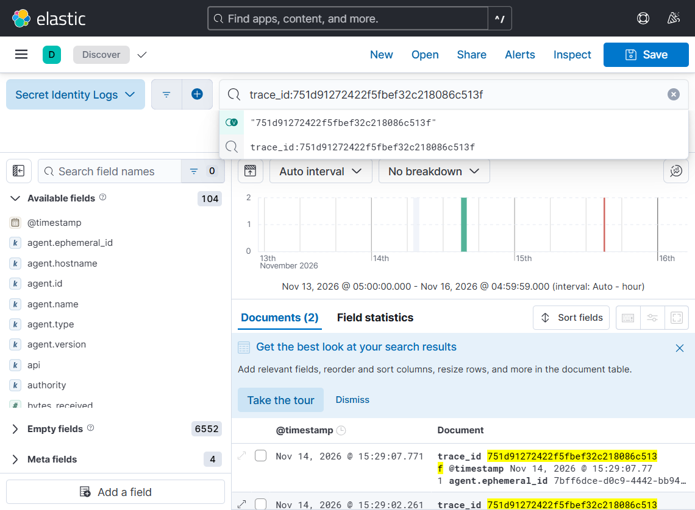

# Assignment 3 — Load Balancing and Observability

**Secret Identity** · Enterprise Software Development, Fall 2026
**Name:** Syed Hamza Omer · **Student ID:** 08962

For this assignment I put the same DC guessing game behind Envoy and ran it as three replicas, A, B and C. The only thing clients talk to is Envoy, on port 10000 for HTTP and 10001 for gRPC. Prometheus doesn't go through the proxy at all; it scrapes each replica and Envoy's admin port (9901) directly, which is what lets me check the balancer's numbers against what each replica actually handled. Logs go out as JSON on stdout, Filebeat ships them to Elasticsearch, and I read them in Kibana. Everything starts with `docker compose up -d --build`.

I used three named services (app-a, app-b, app-c) sharing one image instead of `--scale`, because in the last part I need to stop and restart one specific replica. Envoy's config is generated from a template by `scripts/envoy-policy.js`, so changing policy is a single command and I never have to hand-edit the YAML.

## Part A — three replicas, identity, trace

Each replica gets its `REPLICA_ID` (A, B or C) from the environment, and I made it show up in three places so I could always tell who answered: the `X-Replica-ID` response header, the `served_by_replica` field in gRPC responses, and a `replica` label on the metrics and the log lines. To start with, the `part-a` policy sends everything to A for both HTTP and gRPC.

For correlation I use an `X-Trace-ID` header (a 32-hex string). If a client doesn't send one, the app falls back to `traceparent` and then to its own request id, so there's always something to join on. Envoy logs the same id as `trace_id` along with the replica it picked, and each replica logs the trace id and its own name. So one trace id pulls back two documents, one from the proxy and one from the backend, for the same request.

The part worth being honest about is state. Game sessions, the idempotency cache and the rate-limit windows all live inside a single process, so they're per replica. The only genuinely shared piece is the Envoy routing config. That's fine for the stateless routes I test here (`/api/characters` and `GetCharacters`), but if you start a game on one replica and your next guess lands on another, you get a 404 because that replica has never seen it. The replica headers at least make that visible instead of hiding it.

## Part B — dashboards, metrics, logs

Prometheus ends up with nine targets: the three HTTP replicas, the three gRPC replicas, Envoy, node-exporter and itself. The dashboard I exported (uid `secret-identity-a3-lb`) has one row for HTTP and one for gRPC, and each row shows request rate and share per replica, the active request count, p50 and p95 over a five-minute window, and errors broken down by status.



*Figure 1. The dashboard during a round-robin run. The three replica series overlap in the rate panel and sit near 33% in the share panel, which is the visual version of the Part C result.*

The load client (`scripts/loadgen.js` and the gRPC one) sends on a fixed schedule, one request every `1000/N` ms for `--rate N`, and it doesn't wait for a reply before sending the next one (there's a 256 in-flight cap just to stop it running away). There are no retries and no circuit breaker, so a failure is recorded as a failure rather than quietly retried. It reports sent, successes, failures, per-replica counts, status codes and client-side p50/p95/p99.

Filebeat's Docker autodiscover finds the containers I labelled and writes to `secret-identity-logs-*`. I had to rename a few fields (`service` to `log_source`, `interface` to `api`) because ECS already maps those names to objects and a plain string gets rejected. Searching a single trace id returns the Envoy access-log event and the replica's own line together, for both interfaces:

```text
HTTP  trace e2212dfc…  [envoy] replica=C status=200 4ms /api/characters
                       [secret-identity] replica=C status=200 2.2ms /api/characters
gRPC  trace 80a18ef8…  [envoy] replica=C grpc_status=OK 5ms GetCharacters
                       [secret-identity-grpc] replica=C status=OK 0ms GetCharacters
```



*Figure 2. Kibana Discover over the `secret-identity-logs-*` data view: one trace id returns the Envoy access-log event and the replica's own line, both carrying `replica: C`, so the proxy's choice and the backend's self-report can be reconciled.*

## Part C — adding B and C

`part-c` puts all three replicas into both clusters with equal weight and `ROUND_ROBIN`. The gRPC listener runs HTTP/2, and that's the part that actually matters: on one HTTP/2 connection Envoy treats each RPC as its own stream, so it picks a replica per call rather than pinning the whole channel to whichever replica the connection happened to land on. The split came out even:

| Run | Interface | sent / ok | A | B | C | client p95 |
| --- | --- | --- | --- | --- | --- | --- |
| part-c | HTTP | 1800 / 1800 | 601 | 600 | 599 | 12.0 ms |
| part-c | gRPC | 1800 / 1800 | 600 | 600 | 600 | 28.2 ms |

## Part D — strategies, failure and recovery

Weighted round robin at 2:1:1 gave HTTP 901 / 450 / 449 and gRPC 899 / 450 / 449, so basically 50/25/25 as configured.

For least-request I slowed replica B down with a 100 ms delay on every request and ran the same load under plain round robin as a control. Round robin carried on giving B its third (450 / 451 / 449). Least-request noticed B was slow and moved traffic away from it (HTTP 494 / 285 / 571, so B got about 21%; gRPC was similar at 20%). The client p95 was around 110 ms either way, but under least-request fewer requests were stuck queueing behind the slow replica.

The failure test uses Envoy's active health checks:

| Setting | Value |
| --- | --- |
| Probe | HTTP `http_health_check` on `/api/health`; gRPC `tcp_health_check` |
| interval / no_traffic_interval / unhealthy_interval | 2s / 2s / 2s |
| timeout | 1s |
| unhealthy_threshold / healthy_threshold | 3 (about 6s to eject) / 2 (about 4s to re-admit) |

Two of these settings weren't obvious. First, `no_traffic_interval` defaults to 60 seconds, so on my first attempt B stayed "healthy" for ages after I stopped it; you have to set it explicitly to keep probing every 2s when there's no traffic. Second, I had to pin the endpoints as `STATIC` instead of `STRICT_DNS`, because with DNS Docker stops resolving the stopped container and Envoy drops it before the health check gets a chance to do anything. With the IPs pinned, the health check is what ejects it.

I stopped B at 25s and restarted it at 50s. Envoy ejected it 7.2s after it actually died (three failed checks) and let it back in 5.6s after the restart. From the client side, 2176 of 2250 requests succeeded (96.71%), and all 74 of the 503s fall in a nine-second window (roughly t=28 to 36s), which is exactly the gap between B dying and Envoy removing it. Once B was out, the 503s stopped.

Here is everything in one table:

| Run | Policy | Interface | sent / ok | A / B / C | client p95 |
| --- | --- | --- | --- | --- | --- |
| part-a | only A | HTTP | 1800 / 1800 | 1800 / 0 / 0 | 11.4 ms |
| part-a | only A | gRPC | 1800 / 1800 | 1800 / 0 / 0 | 28.2 ms |
| part-c | round robin | HTTP | 1800 / 1800 | 601 / 600 / 599 | 12.0 ms |
| part-c | round robin | gRPC | 1800 / 1800 | 600 / 600 / 600 | 28.2 ms |
| weighted | 2:1:1 | HTTP | 1800 / 1800 | 901 / 450 / 449 | 13.0 ms |
| weighted | 2:1:1 | gRPC | 1800 / 1800 | 899 / 450 / 449 | 28.5 ms |
| round robin, 100 ms on B | round robin | HTTP | 1350 / 1350 | 450 / 451 / 449 | 110 ms |
| least-request, 100 ms on B | least-request | HTTP | 1350 / 1350 | 494 / 285 / 571 | 110 ms |
| least-request, 100 ms on B | least-request | gRPC | 1350 / 1350 | 555 / 275 / 520 | 110 ms |
| health checks (B down 25–50s) | round robin | HTTP | 2250 / 2176 | — | — |

To make sure the distribution wasn't just something my client was imagining, `scripts/access-log-check.js` counts the replicas in Envoy's own access log over the run's window. For weighted HTTP the client said 901 / 450 / 449 and the proxy's log said the same, exactly. The other runs I checked lined up too (part-c HTTP 601 / 600 / 599, least-request 494 / 285 / 571).

## Conclusions

Round robin is the right default for both protocols here, because the replicas are identical and every request costs about the same. It matters more for gRPC, since HTTP/2 is what lets Envoy balance per call rather than per connection. Least-request only earns its place when the replicas aren't interchangeable, which is what the delay test showed. Weighted is for when the replicas genuinely differ in capacity, not something I'd use by default.

The one place I'd choose differently is anything stateful or long-running. Because the game state is per replica, a call that has to reach the replica holding that state breaks under round robin, since the wrong replica just returns a 404. There I'd use ring-hash or session affinity so a given game id always lands on the same replica, or move the state into a shared store.

If Envoy itself stops, everything stops. It's a single instance, so clients on 10000 and 10001 get connection refused and none of the three healthy replicas get any traffic. The health checks only help when a replica dies; they do nothing for the proxy. It comes back quickly because of `restart: unless-stopped`, but while it's down the whole thing is down.

The improvement I'd make next is to run two or more Envoy instances behind a small load balancer so the proxy isn't a single point of failure, and move the routing config to a control plane (xDS) so I don't have to recreate the container to change policy. After that, a shared session store, so the stateful routes could be balanced too.
